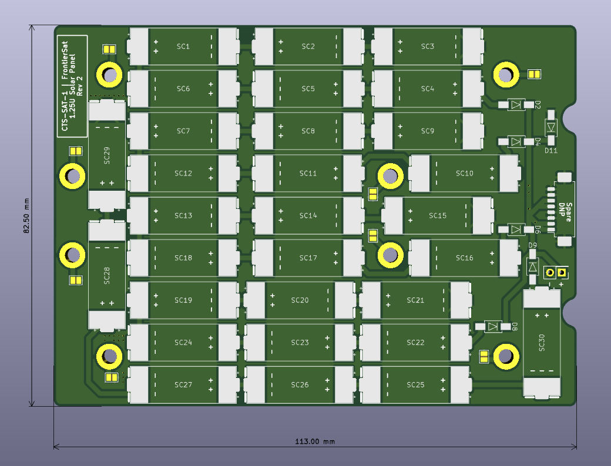

# CTS-SAT-1-Solar-Panels

Solar panel PCB designs for the CTS-SAT-1 (FrontierSat) 3U cubesat

## Solar Panel Overview
* 4x COTS 2U solar panels are the main power generation for the satellite. Model: [NPC SpaceMind](https://www.npcspacemind.com) SM-SP2X.
* As a proof of concept, the following panels are manufactured in-house (designed contained in this repo):
    * 2x 1.25U panels
    * 1x 1.0U panel

The `rev3` release/tag, with PCBs manufactured by AISLER, is flown on CTS-SAT-1.

## 1.25U Solar Panel

* 30 cells, in a 6S5P configuration (6 cells in each string, then joined in parallel).

## Bill of Materials (Highlights)
* PMEG3010EP diodes in a SOD128 package (low VF Schottky barrier rectifier)
* [AA-DUCT 902 Silver Epoxy Adhesive](https://atomadhesives.com/aa-duct-902-silver-epoxy-adhesive-electrically-conductive-room-temp-curing-air-dr/)
* KXOB25-05X3F solar cells
    * Nominal efficiency: 25%
    * Monocrystalline, silicon composition
    * Very cost-efficient

## Solar Panel Assembly Steps
Work in the Laminar Flow Table with proper ESD protection. Wear gloves. Be careful with fragile cells.

1. Assemble SMD solder components.
2. Clean solar panel PCB with isopropyl alcohol (clean flux residue).
3. Put epoxy in hot water for 10 minutes (get epoxy to around 40C, warm-to-touch).
4. Massage epoxy in pouch, following epoxy supplier's guidelines.
5. Get out the solar cells.
6. Apply some epoxy to solar panel pads.
7. Take a picture of the application for reference on future applications.
8. Use the suction tool or hands to place solar cells on the panels. Press down on each cell.
9. Wait 24h for epoxy to dry.

## License
This project is licensed under the [CERN OHL v2 Permissive](https://choosealicense.com/licenses/cern-ohl-p-2.0/) license. We appreciate attribution and links back, but you are free to do what you wish with this project.
